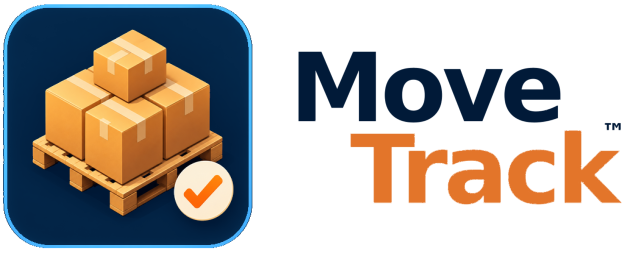

<p align="center">
  
</p>

<h1 align="center">MoveTrack</h1>
<p align="center">Da produção à logística, cada movimentação acompanhada.</p>

<p align="center"><strong>Produção · Logística · Administração</strong></p>

Aplicação web desenvolvida para digitalizar o controle de transferência de produtos acabados entre a fábrica e o galpão de armazenagem da Melodia Pet.

**Versão atual:** `v1.5.0` · Consulte o histórico em [CHANGELOG.md](CHANGELOG.md).

## O desafio

O acompanhamento das movimentações era feito em papel: para cada palete pronto, a equipe anotava produto, número da ordem de produção (OP), quantidade e as confirmações de saída e recebimento. Além de consumir tempo, esse processo dificultava a consulta do saldo pendente, a consolidação mensal e a comunicação diária com a logística.

O objetivo do projeto foi substituir esse controle manual por uma rotina simples de usar no celular ou tablet, sem exigir digitação no processo operacional.

## A solução

Cada capa de produção passa a receber um QR Code com as informações do palete:

```text
IDENTIFICADOR_UNICO|PRODUTO|NUMERO_OP|QUANTIDADE
```

Exemplo:

```text
10123-030926-11:57:30-000381|M1x Seed Papagaio|1001|500
```

Com a leitura do QR Code, o sistema registra automaticamente o palete como pronto para transferência. O identificador combina código do produto, data/hora e sequência para evitar duplicidades.

## Fluxos operacionais

### Produção

- Registra paletes prontos por leitura de QR Code;
- Mantém a lista de paletes pendentes até a transferência real;
- Permite cancelar um palete pendente após confirmação, com motivo opcional;
- Permite retirar unidades avulsas de um palete para adiantamentos, reduzindo o saldo do palete original.

### Logística

- Adiciona os paletes recebidos por leitura de QR Code;
- Inclui unidades avulsas disponíveis no mesmo recebimento;
- Agrupa vários paletes e/ou avulsos em uma única confirmação;
- Exige assinatura digital antes de habilitar a confirmação do recebimento;
- Permite corrigir inclusões acidentais antes da confirmação.

### Administração

- Centraliza todas as funções de Produção e Logística, inclusive entradas manuais como contingência;
- Exibe relatório mensal de movimentações com totalizadores;
- Diferencia visualmente recebimentos de paletes e de unidades avulsas;
- Mostra a assinatura, data/hora e os itens que compõem cada recebimento;
- Gerencia o catálogo de produtos, com pesquisa, fotos, edição e importação manual da planilha do Sankhya;
- Exporta relatórios em PDF e CSV, respeitando filtros e ordenação;
- Configura o webhook, dias e horário do resumo automático enviado ao Discord.
- Permite configurar linhas de produto, cores de identificação e uma cor padrão para itens sem regra.

## Comunicação com a logística

O sistema consolida os paletes pendentes e pode enviar um resumo automático ao canal de logística no Discord, por exemplo:

```text
5 paletes
1.000 unidades de M1x Seed Papagaio
500 unidades de M1x Seed Periquito
```

O envio é configurável por dia da semana e horário, permitindo adaptar a rotina ao encerramento diário da fábrica.

## Decisões de projeto

- **Sem login na operação:** Produção e Logística usam links diretos para reduzir burocracia. A validação do destino é registrada pela assinatura digital.
- **QR Code em vez de digitação:** reduz erros e torna o registro rápido no chão de fábrica.
- **Recebimento em lote:** reflete a operação real, na qual vários paletes são transportados e recebidos juntos.
- **Dados persistentes separados da aplicação:** permite atualizar o sistema sem perder os registros operacionais.
- **Configurações privadas persistentes:** webhook do Discord e demais configurações ficam dentro da pasta local `data`, fora do GitHub.
- **Interface responsiva:** pensada para uso em celular, tablet e computador na rede interna.
- **Aplicativo instalável (PWA):** em dispositivos compatíveis, pode ser instalado pelo navegador e aberto em uma janela própria.

## Experiência de uso

A interface mantém uma identidade própria para cada área: azul na Produção, amarelo na Logística e laranja na Administração. O menu lateral recolhível organiza as funções por equipe. A leitura de QR Code, os avisos com ícones e a animação de carregamento ajudam a acompanhar cada operação.

O catálogo é local e pode ser mantido manualmente ou importado de uma planilha, sem depender de conexão com o ERP durante a operação. As instalações PWA de Admin, Produção e Logística têm acessos independentes.

## Tecnologias utilizadas

- Node.js, utilizando apenas recursos nativos para o servidor HTTP e APIs;
- HTML, CSS e JavaScript puro no front-end;
- Leitura de QR Code pela câmera do dispositivo, quando suportada pelo navegador;
- Docker e Docker Compose para padronizar a execução no servidor;
- Webhook do Discord para a comunicação automática com a logística.

## Próximos passos possíveis

O projeto foi estruturado para validar a rotina operacional. Em uma evolução futura, o armazenamento local pode ser migrado para um banco de dados relacional, com backup automatizado e maior suporte a acessos simultâneos.


## Acesso administrativo e dispositivos

No celular e no tablet em retrato, o menu abre sobre o conteúdo e os pendentes são apresentados em cards. O tablet em paisagem segue a organização do desktop.

A opção **Manter conectado** conserva a sessão por até 30 dias, inclusive após reiniciar o container. As sessões ficam em `sessions.json`, ao lado dos dados operacionais no volume privado `data/`, com apenas o hash do token. A senha não é armazenada no navegador. O botão **Sair** invalida a sessão no servidor. Sem marcar a opção, a sessão dura até 12 horas e não sobrevive ao reinício do servidor. Após esta atualização, entre uma vez e marque a opção para criar uma sessão persistente.


## Atualização silenciosa

Os dados operacionais são consultados a cada cinco minutos com a página visível e ao retornar à aba (com um intervalo mínimo de 15 segundos entre tentativas por foco). Novos paletes aparecem automaticamente nos pendentes na próxima consulta, sem F5. A navegação não recarrega a página nem substitui os formulários, a observação ou o canvas de assinatura. Consultas usam ETag para evitar reenviar dados sem alterações; uma falha de rede aguarda a próxima tentativa e mantém a sessão. O relatório continua respeitando o botão Aplicar e os filtros escolhidos.


## Identificação dos produtos

No QR `10116-291026-09:26:58-00005204|M1X SEED CALOPSITA / AGAPORNIS 500G|9147|1000`, o código é 10116. Ele é exibido e usado na URL da imagem mesmo sem cadastro. Se esse código existir no catálogo, o nome cadastrado é exibido; caso contrário, é usado o nome original do QR. A descrição não é comparada para identificar o produto. Os vínculos de paletes e avulsos existentes são recuperados na leitura dos dados, sem apagar movimentações ou alterar quantidades.

## PDF e relatório mensal no Discord

O PDF do Admin é gerado no servidor, abre no visualizador do navegador para salvar ou imprimir e inclui `PÁG X DE Y`. Os filtros de mês, tipo e ordenação são respeitados. O envio mensal sempre usa todos os tipos, em ordem cronológica, e o mês anterior no fuso `America/Recife` (Brasília).

Em Configurações > Discord, escolha Sim/Não, dia e horário. O mesmo webhook vale para o resumo diário e para o PDF mensal. O padrão é dia 1 às 07:00. O envio considera apenas ocorrências posteriores à ativação ou alteração do agendamento, evitando enviar um mês antigo assim que a versão é instalada. Se o dia escolhido não existir em determinado mês, usa o último dia daquele mês. Se o servidor voltar após o horário agendado dentro do mesmo mês, o envio é retomado; falhas são tentadas novamente após cinco minutos.

O controle de confirmação do envio fica em `monthly-reports.json`, no mesmo diretório privado dos dados operacionais, preservado pelo volume `data/` e fora do GitHub. Só é marcado como enviado após o Discord confirmar a mensagem. O servidor precisa estar em execução e ter conexão com o Discord; o navegador não precisa ficar aberto.

A imagem Docker instala as dependências fixadas no `package-lock.json` por `npm ci --omit=dev`. Após o pull, reconstrua a imagem como de costume com `docker compose up -d --build`. Os dados, configurações, certificados e sessões existentes são preservados.

## Verificação

Após instalar as dependências com `npm ci`, execute `npm test`. Os testes cobrem identificação por código e recuperação dos registros, filtros do relatório e virada do mês no fuso local, geração de PDF, agenda mensal, confirmação de anexo e controle de repetição/retry com Discord simulado.
